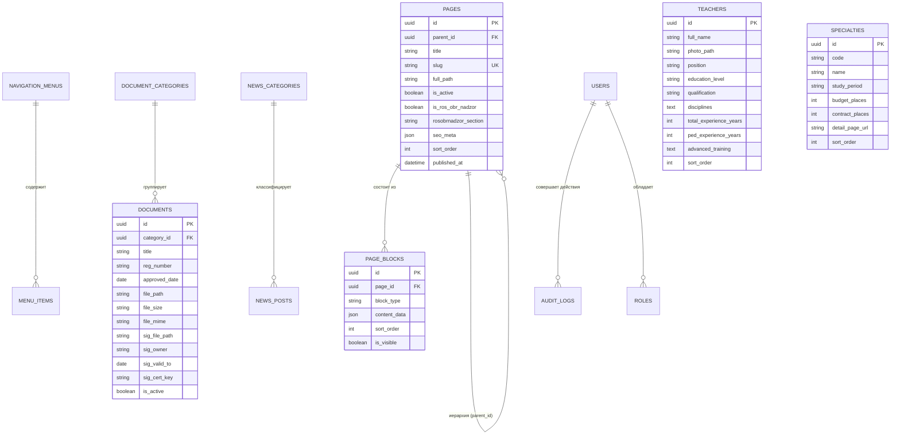

# Архитектурный проект и спецификация данных (Этап 1 ТЗ)
## Модернизация и миграция официального сайта АКВТ с WordPress на независимый стек

> **Цель этапа:** Полный отказ от монолита WordPress и структуры `wp_postmeta`, утверждение нормализованной схемы реляционной базы данных (PostgreSQL / MariaDB), проектирование 8 компонентов блочного конструктора страниц (Page Builder), реестров нормативных документов с ЭЦП, педагогического состава и ролевой модели (RBAC).

---

## 1. Выбор целевого стека

Для официального государственного колледжа в РФ утверждён **Вариант A: PHP 8.3+ / Laravel 12 + Filament v3 + PostgreSQL**:
* **Совместимость с требованиями РФ:** Полная поддержка развертывания на отечественных операционных системах (Astra Linux SE, РЕД ОС, Альт Линукс) и СУБД (Postgres Pro).
* **Административная панель Filament v3:** Самый эргономичный и функциональный инструмент для контент-менеджеров и методистов. Из коробки закрывает требования к таблицам, древовидным структурам, Drag-and-Drop и аудиту.
* **Производительность:** TTFB < 80 мс благодаря OPcache и кэшированию запросов, потребление памяти в 3–5 раз ниже Node-серверов.
* **Связка с текущей вёрсткой:** Существующая дизайн-система сайта АКВТ («Тёплый редакционный техножурнал», [style.css](file:///e:/аквт/AKVT/site/css/style.css)) переносится в Blade-компоненты напрямую без необходимости полной переписки фронтенда на React.

---

## 2. Нормализованная схема реляционной базы данных



---

## 3. Спецификация 8 блоков конструктора страниц (Page Builder)

Каждый блок хранится в таблице `page_blocks` как независимая запись со схемой данных `json content_data`:

| Тип блока (`block_type`) | Структура полей (`content_data`) | Назначение в шаблоне |
| :--- | :--- | :--- |
| **1. `hero_banner`** | `{ title, subtitle, image_url, cta_buttons: [{ label, url, style }], alignment }` | Главный промо-экран страницы с заголовком и кнопками действия |
| **2. `rich_text`** | `{ html_content, container_width, callout_style }` | Очищенный WYSIWYG-контент (H2–H4, списки, цитаты, адаптивные таблицы) |
| **3. `accordion_faq`** | `{ items: [{ question, answer_html, default_open }] }` | Интерактивные раскрывающиеся спойлеры для ЧАВО и правил поступления |
| **4. `document_registry`** | `{ category_id, manual_doc_ids: [], show_sig_badge, limit }` | Сетка нормативных актов с датой, размером файла и плашкой ЭЦП |
| **5. `specialties_grid`** | `{ filter_level, featured_ids: [], show_places_count }` | Карточки образовательных программ (09.02.07, 10.02.05 и др.) |
| **6. `news_feed`** | `{ category_id, limit, show_pagination, show_archive_link }` | Сетка актуальных анонсов и событий колледжа |
| **7. `media_gallery`** | `{ photos: [{ url, caption, alt }], layout: "grid"|"slider" }` | Фотогалерея с Lightbox-увеличением снимков высокого разрешения |
| **8. `feedback_form`** | `{ target_email, department, title, consent_pdn_text, fields: [] }` | Защищённая форма обращений граждан с соблюдением 152-ФЗ |

---

## 4. Специализированные нормативные реестры

### 4.1. Реестр документов и локальных нормативных актов с ЭЦП
* **Файлы:** строгое хранение PDF в изолированном каталоге `/storage/documents/`.
* **ЭЦП (Федеральный закон № 63-ФЗ):** возможность прикрепления парного файла подписи `.sig`.
* **Штамп ЭЦП:** автоматическая генерация визуального штампа в публичном интерфейсе:
  ```html
  <div class="akvt-doc-sig" itemprop="docFile">
    <span class="sig-icon">🔒</span>
    <span class="sig-title">Документ подписан простой электронной подписью</span>
    <div class="sig-meta">
      <div>Владелец: <strong>{sig_owner}</strong></div>
      <div>Срок действия: <strong>до {sig_valid_to}</strong></div>
      <div>Отпечаток: <code>{sig_cert_key}</code></div>
    </div>
  </div>
  ```

### 4.2. Педагогический состав (Приказ Рособрнадзора № 831)
* Таблица `teachers` содержит все регламентированные атрибуты (`itemprop="teachingStaff"`).
* Автоматическая сортировка по должностям (Руководство, Заведующие отделениями, Преподаватели).

### 4.3. Сквозные глобальные параметры (Синглтоны)
Хранятся в таблице `site_settings`:
* Официальное наименование организации (полное и сокращенное).
* Контакты приемной комиссии, телефон доверия, email.
* Социальные сети (ВКонтакте, Telegram-канал).
* Коды счетчиков и аналитики (Яндекс.Метрика с режимом защиты персональных данных).

---

## 5. Ролевая модель доступа (RBAC)

| Роль | Доступ к разделам админ-панели | Ограничения |
| :--- | :--- | :--- |
| **Суперадминистратор** | Полный доступ (Настройки, Пользователи, Резервные копии, Логи аудита, Все страницы) | Без ограничений |
| **Методический отдел** | «Документы», «Педсостав», «Образовательные программы», «Сведения об ОО» | Запрещено менять структуру главного меню и системные настройки |
| **Пресс-служба (Редактор)** | «Новости», «Фотогалереи», «Объявления», «Баннеры» | Доступ только к публикации новостных материалов |
| **Приемная комиссия** | «Абитуриенту», «Специальности», «Вакантные места», «Обращения» | Доступ ограничен приемной кампанией |

---

## 6. Регламент и ETL-скрипт миграции данных из WordPress

```
[WordPress SQL / wp_posts & wp_postmeta] 
       │
       ▼  (ETL Python / PHP CLI)
1. Фильтрация (post_status = 'publish')
2. Очистка от шорткодов (\[vc_.*?\], \[contact-form-7.*?\], \[gallery.*?\])
3. Очистка стилей конструкторов (WPBakery, Elementor)
4. Трансформация медиа-ссылок: /wp-content/uploads/ -> /storage/uploads/
5. Нормализация слагов и генерация таблицы 301-редиректов
       │
       ▼
[Новая реляционная БД: PostgreSQL / MariaDB]
```

### Таблица 301-редиректов (`redirects`)
Для гарантии сохранения SEO-позиций и ссылочной целостности:
* `old_url`: `/students/raspisanie-zanyatij/`, `new_url`: `/students/raspisanie/`
* `status_code`: `301 Moved Permanently`
* Любой входящий запрос перед отдачей 404 проверяется по индексу таблицы редиректов.

---

## 7. Чек-лист соответствия законодательству

- [x] **Приказ Рособрнадзора № 831:** Поддержка всех `itemprop` атрибутов на серверном уровне.
- [x] **ГОСТ Р 52872 (Версия для слабовидящих):** Переключатель контрастности, масштаба и скрытия изображений без деформации сетки.
- [x] **152-ФЗ «О персональных данных»:** Чекбоксы согласия, логирование IP и даты согласия, размещение серверов в РФ.
- [x] **Безопасность:** Запрет исполнения исполняемых файлов в каталогах загрузки (`location ^~ /storage/ { ... php execution denied }`).
